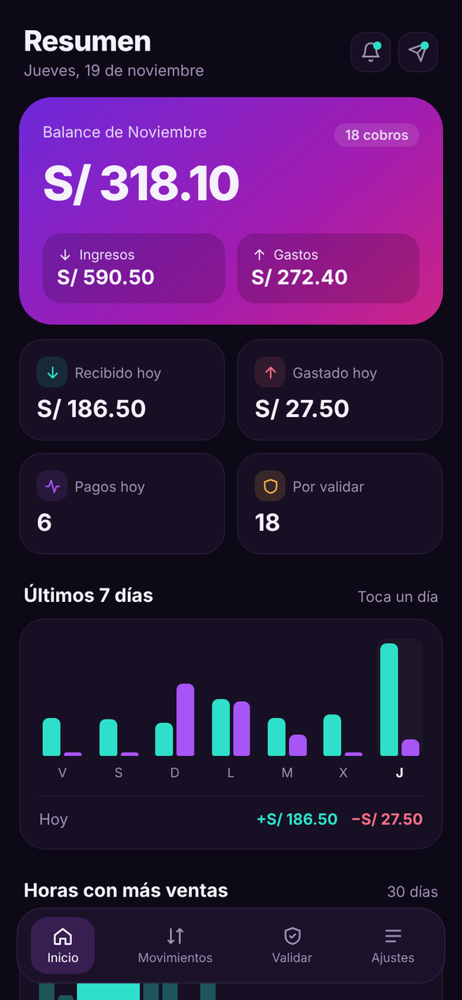
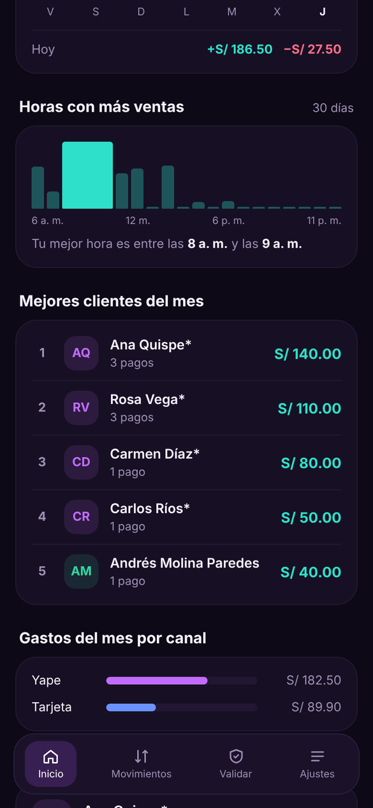
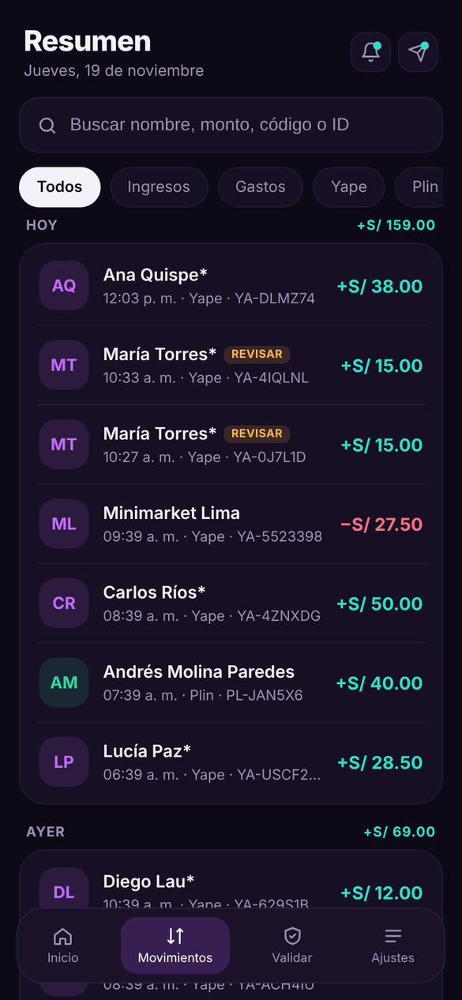
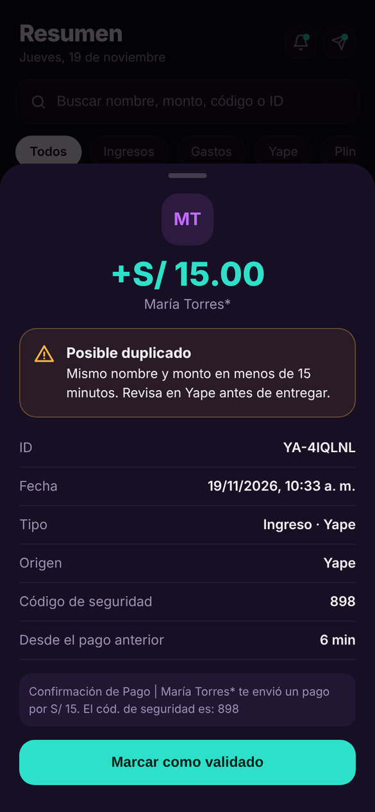
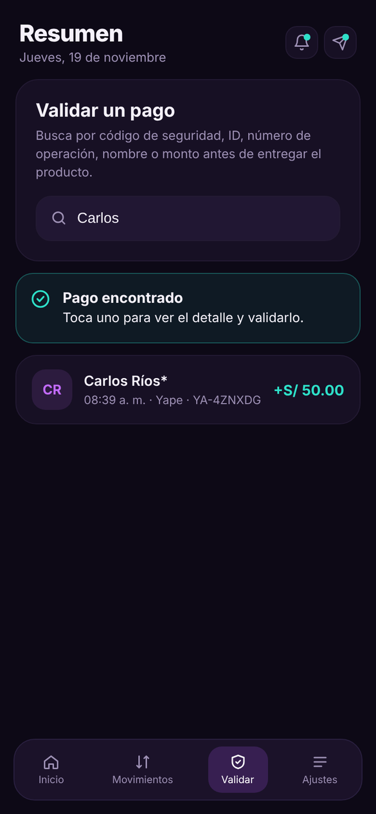
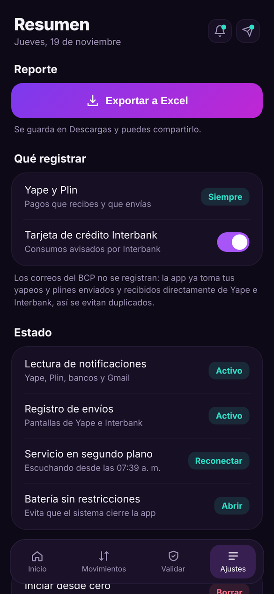

# 📡 Yape Monitor

**Registro automático de tus Yapes, Plines y gastos, directo en tu celular Android.**

Yape Monitor escucha las notificaciones de Yape y Plin, y anota cada pago que recibes y cada pago que haces, sin que tengas que tocar nada. Puedes validar los cobros antes de entregar un producto y exportar todo a Excel.

  &nbsp;
  &nbsp;
  

  &nbsp;
  &nbsp;
  

Capturas con datos de ejemplo.

## ✨ Funciones

- **Ingresos automáticos**: Yape y Plin, al instante en que llega la notificación
- **Gastos automáticos**: yapeos que envías, plines desde Interbank y consumos con tarjeta de crédito Interbank
- **Seguridad anti-fraude**
  - ID único por movimiento
  - Alerta de posibles pagos duplicados
  - Estado *validado*: si te muestran el mismo comprobante dos veces, la app te avisa
  - Tiempo transcurrido desde el pago anterior
- **Aviso por voz** cuando te llega un pago
- **Dashboard**: balance del mes vs. mes anterior, ingresos y gastos del día, gráfico semanal, horas con más ventas, mejores clientes y gastos por canal
- **Exportar a Excel (.xlsx)** con totales y resumen diario
- Funciona en **segundo plano**, aunque la app esté cerrada
- **100 % local**: sin internet ni servidores, tus datos no salen de tu celular

## 📱 Requisitos

- Android 8.0 o superior (exportar a Excel: Android 10+)
- Permiso de acceso a notificaciones

## 🛠️ Tecnología

App nativa Android ligera (~25 KB) con interfaz web integrada, servicio de lectura de notificaciones y servicio de accesibilidad para confirmar envíos. Genera archivos Excel reales sin librerías externas.

## ⚠️ Aviso

Proyecto independiente, no afiliado a Yape, BCP, Interbank ni Plin.

---

© 2026 ElBryan-dev. Todos los derechos reservados. El código fuente es privado.
